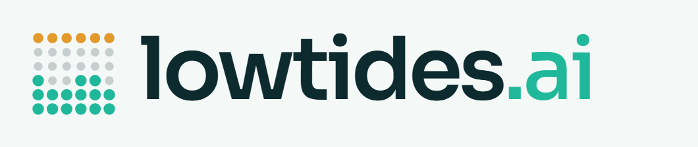

<p align="center"></p>

# Lowtides: Consent Shopping

**Consent for agentic commerce: both say yes, or no money moves.**

Let an AI shopper buy for you without handing it your wallet. Your shopper carries a signed **Pass** (your rules). Every store publishes a signed **Store Policy** (its rules for AI shoppers). **GuardPooch** checks the store is real. The **Handshake** checks both directions, and only a match pays, through **PayPal** (sandbox in the demo). One **Stop all** button revokes the Pass at every store at once.

**Live demo: https://lowtides.ai** (no login needed). **Video (2:55): https://youtu.be/qt9pDoqOMFI** It is a public demo: stores are fictional and money is PayPal sandbox test money. With the server's sandbox keys set, a Handshake match is a real PayPal sandbox payout and the guide answers with AI; without them the same flow runs simulated, and every receipt and answer says which it was. Each browser gets its own private copy of the demo, and there is a "Reset demo" button. Open source, AGPL-3.0. Patent pending.

**Testing window:** the demo stays live and unchanged until the winners are announced (Dec 21, 2026). No commits, README edits or video changes after the submission deadline (Thu Nov 12, 2026, 12:00 pm PT).

> **Built with PayPal and AI.** PayPal APIs: Orders v2, Payouts, Invoicing v2, Vault v3 payment tokens, Webhooks with signature verification, and a guard for the PayPal Agent Toolkit. AI: a language model turns plain-English rules into strict rules and powers the "Ask Lowtides" guide (one model in the live demo, under a daily cost cap, with a scripted fallback); an AI voice can read its answers aloud when the owner turns it on. The older cost-control side works with several LLM providers (OpenAI-style and Anthropic-style APIs). The AI never decides a payment; code does. An AI coding assistant helped build it.

## Judges: try it in 2 minutes (no password)

| Open | What it is |
|---|---|
| **[lowtides.ai/shop/](https://lowtides.ai/shop/)** | **Shopper control center.** Design your Pass (Careful, Balanced or Hands-off), set limits, pick Off / AI Assist / Full Autopilot, type or say what you want, read receipts with an activity chart and CSV export, press Stop all. |
| **[lowtides.ai/shop/#muzzle](https://lowtides.ai/shop/#muzzle)** | **Action Muzzle.** Not just shopping: tell the AI the job and it does only that. Book a table and the deposit pays through PayPal sandbox; an extra it was not asked for waits for you; a lookalike is refused. Say the stop word and everything freezes. |
| **[lowtides.ai/merchants/](https://lowtides.ai/merchants/)** | **Store control center.** Sign and publish a Store Policy for AI shoppers, see orders and trust labels. |
| **[lowtides.ai/handshake/?tour=1](https://lowtides.ai/handshake/?tour=1)** | **Live split-screen Handshake** and the 6-step guided tour, narrated aloud (recorded voice, mute button on the stage). Every step is a real call to the server. |
| **[lowtides.ai/app/](https://lowtides.ai/app/)** | **Developer dashboard:** agents, budgets, approvals, the AG Grid "Every call" ledger. |
| **Ask Lowtides** (button on every page) | The AI guide. Type, or press **Talk** to speak with it and hear the answer. Say "give me the tour". |
| **Sign in** (top right, when shown) | Optional free shopper or store account that keeps your own dashboard. Everything also works without it. |
| **[lowtides.ai/tools/](https://lowtides.ai/tools/)** | **Free tools.** Build your AI shopper rules, a store's rules for AI shoppers, and pick a stop word. Runs in the browser; nothing typed is sent anywhere. |
| **[lowtides.ai/blog/](https://lowtides.ai/blog/)** | **Why this is needed.** Eight plain-English guides, two with sourced charts: why AI shopping needs a yes from both sides, and why a spending limit alone is not enough. |
| **[lowtides.ai/openapi.json](https://lowtides.ai/openapi.json)** | The whole API, plus a Postman collection in `docs/postman/`. |

Nothing needs a password or a card. Each browser gets its own private copy of the demo and a "Reset demo" button. Money is PayPal sandbox test money and the stores are fictional. Patent pending.

**Everything in it, by name**

- **PayPal (sandbox):** Payouts (settles a Handshake match), Orders v2 (wallet top-ups and authorize-then-capture holds), Vault v3 payment tokens (always simulated in the public demo and labeled so), Invoicing v2, Webhooks with signature verification. Every receipt says whether it was a real sandbox call or simulated.
- **Action Muzzle:** the same both-sides consent check for what an AI does besides buying (reserve, schedule, book travel, call, sign up, cancel, message, send a form, share details). The job the person gives becomes a scope and the AI may do only that; each business publishes a signed policy; a deposit or fare is paid through PayPal sandbox only after both say yes; every action gets a signed receipt; a stop word freezes everything. Demo businesses are fictional and nothing real is contacted. `docs/ACTION-MUZZLE.md`.
- **PayPal Agent Toolkit guard:** `integrations/paypal-agent-toolkit/` puts the same rules in front of an agent that uses PayPal's toolkit.
- **MCP server:** `lowtides/mcp.py`, seven tools, behind "Connect your own AI".
- **AI in the product:** Claude Haiku 5.5 (Anthropic API) turns plain-English rules into strict rules and answers in the Ask Lowtides guide, under a hard daily cost cap with a scripted fallback. The AI never decides a payment; plain code does.
- **Voice:** the Talk button uses the browser's own speech by default. When the owner switches it on, Talk opens a short call with a separate "Ask Lowtides" voice assistant on Vapi (ElevenLabs voice, Deepgram transcription, Claude model), recording off, three minutes at most.
- **Accounts:** optional sign-in with Supabase Auth; the password never reaches Lowtides. See `docs/ACCOUNTS.md`.
- **Signed webhooks:** outbound, signed JSON for approvals and stops, built for a Zapier Catch Hook or Make and tested against a local receiver (no live Zap).
- **Also:** GuardPooch (the store watchdog), Stop all, receipts with plain-English search (rule-based, no AI), Off / AI Assist / Full Autopilot on both sides, an attack bench (31 of 31 stopped).

## Why this is not a prompt wrapper

- **Code decides, not a prompt.** No AI model ever approves a payment. Every limit is enforced by plain, tested code (`lowtides/handshake.py`, `lowtides/spend.py`). The AI only turns typed rules into strict rules a person reviews, and answers questions.
- **Both sides are signed.** The shopper's Pass and the store's Policy are Ed25519-signed documents. Anyone can verify a decision with public keys only, and changing one byte breaks the check.
- **The server re-checks the price.** When an AI shopper buys a listed item, the price comes from the store's own catalog on the server, not from what the AI says, so a stale or made-up price does not get through.
- **The store is checked before paying.** GuardPooch checks for lookalike names, very new domains, unsigned rules and prices that are too good to be true, and a failed check means no payment. A refused fake store can be reported in one press: you get a signed report and the official FTC and FBI IC3 links (nothing is sent for you).
- **Attacks are tested, not assumed.** The attack bench runs 31 attacks (prompt injection, a lookalike store, over-limit and over-budget buys, and more); 31 of 31 are stopped with $0.00 moved, and the automated test suite passes.
- **Built on PayPal's own tools.** Money moves through PayPal Payouts and Orders in the sandbox, and `integrations/paypal-agent-toolkit/` puts the same rules in front of any agent that uses the PayPal Agent Toolkit.

## Judge it in 3 clicks

| Click | Where | What you see |
|---|---|---|
| 1 | **[Play the 90-second tour](https://lowtides.ai/handshake/?tour=1)** | Six live steps on one stage: a green buy through PayPal sandbox, a yellow one that waits for a person, a fake store refused, trust earning its way into a stricter store, Stop all turning every store red, and the shopper back on. Every step is a real call to the running server. |
| 2 | **[Search from the front door](https://lowtides.ai/)** | Type "cordless drill" in the search bar. The AI shopper lists matches from five demo stores with a green, yellow or red light on each. Press **Buy with PayPal sandbox** on a green one and read the signed receipt. |
| 3 | **[Be the store](https://lowtides.ai/merchants/)** | Lower "max order without a person" in the Store Policy. It is signed again, and the same purchase now turns yellow. The store's rules count as much as the shopper's. |

What is different here: most agent-spending tools check **one** side, the buyer's limits. Lowtides also has the **store** publish its own signed rules for AI shoppers (order size with no human, categories, minimum trust score, blocked agents), and one Handshake gives one answer for both. An outside AI agent gets the same answer through the API or MCP ([Connect your own AI agent](#connect-your-own-ai-agent)).

---

## How it fits together

```
 SHOPPER SIDE                                              STORE SIDE
 your rules, in plain words                                the store's rules for AI shoppers
 (AI turns words into strict rules,                        (max order with no human, categories,
  you review them; offline parser w/o a key)                minimum trust, blocked agents)
        |                                                          |
        v                                                          v
   PASS  (Ed25519-signed)  ----------->  HANDSHAKE  <-----------  STORE POLICY  (Ed25519-signed)
   carried by the AI shopper            checks BOTH ways          public at /.well-known/...
                                          ^        ^
                              GuardPooch -+        +- Trust score, both ways
                     "is this store real?"            stores read the agent's score;
                     (checks the store for             the shopper sees the store's record
                      the shopper)

   ASK LOWTIDES (AI, propose-then-confirm): reads all of the above, answers, and PROPOSES.
   Only a person's tap on Confirm runs anything. It has no tool that moves money.

 HANDSHAKE SIGNAL
   green  match      both said yes   --> PayPal Payouts (PayPal sandbox when keys are set, else a labeled simulation)
   yellow needs_yes  a person decides --> held approval --> Approve --> same payout path
   red    no_match   a rule says no   --> nothing moves

   every Handshake --> signed receipt (Ed25519) --> hash-chained audit log --> proof pack
                                                   (anyone verifies it with public keys only)

 Stop all  --> the Pass is revoked at every store at once (every Handshake turns red),
           open PayPal holds are voided, unclaimed payouts are canceled, saved PayPal tokens are deleted
```

AI proposes, code decides. The Handshake can only make a payment harder than the agent's own rules, never easier.

## Step by step (no login)

0. Fastest: press **Play the 90-second tour** on the front door (or open **/handshake/?tour=1**). Six live steps play on one stage: a green buy, a yellow one the tour approves, a fake store refused, trust earning its way into a stricter store, Stop all at every store, and Scout back on. Every step is a real API call; captions are always on, and the speaker button turns the recorded narration on or off. Space plays or pauses, the arrow keys step, Esc exits.
1. Open **https://lowtides.ai**. The front door shows the idea: your Pass is the key, the store's Policy is the lock. Press **Try the demo**.
2. On **/shop/** (the shopper's control center), Scout, the demo AI shopper, lists what it can buy from five demo stores (29 items), green first. On a green item press **Buy with PayPal sandbox**. Both sides say yes, and a signed receipt appears with a PayPal sandbox payout (or a clearly labeled simulation). **Check both sides** looks without buying.
3. Search for **"claw hammer"** and pick the **lookalike store** (Harbor-Hardwarre Outlet) item. GuardPooch says danger (misspelled name, a domain 6 days old, no signed policy, prices 62% too low). Red: no money moves.
4. Pick the $175 miter saw. It is over your ask-me line and the store's no-human limit, so it turns yellow and waits for your yes in the approvals list.
5. Open **/handshake/** ("See both sides") to watch the Pass and the Store Policy checked side by side, check by check.
6. Open **/merchants/** (the store's control center). Edit the Store Policy (for example lower the no-human limit) and it is signed again. Scroll to the store's numbers and the Pass checker.
7. Press **Stop all** (the red button docked on the /shop/ screen) and run any Handshake again: every store now says red, because the Pass is revoked.
8. Anywhere on the site, tap **Ask Lowtides** and type "raise my daily cap to 150". It proposes "Set Scout's daily cap to $150.00"; nothing happens until you tap Confirm.
9. Also on /shop/, in the **1. Your rules** card (below the "Never buy" list), type "never buy gift cards, ask me over $50" into the plain-words box and press **Turn into rules**. It lists only the two rules it understood, and Apply changes only those.

**/app/** is the original dashboard (AI bills, rules in plain English, approvals, audit log, "Every call" grid) for people who want the advanced controls.

**The video on the front door has one switch:** `data-video-id` on the `#video` section in `ui/index.html` (set to the submission video). With it empty, the video block and the "Watch the 3-minute story" card stay hidden. The page shows a local poster (`ui/brand/video-poster.webp` / `.jpg`) and loads the YouTube privacy-enhanced player (`youtube-nocookie.com`, the only frame origin the CSP allows) only after a click.

## Connect your own AI agent

Any AI agent can shop through Lowtides with its shopper's key. On **/shop/**, open **Connect your own AI** and copy a setup. Three ways in, same engine as the site's buttons:

**1. Web call (any agent, any language)**

```bash
# the stores, each store's signed policy for AI shoppers, and the items
curl https://lowtides.ai/v1/stores -H "Authorization: Bearer lt-YOUR-KEY"

# check both sides before buying (nothing is paid)
curl -X POST https://lowtides.ai/v1/handshake \
  -H "Authorization: Bearer lt-YOUR-KEY" -H "Content-Type: application/json" \
  -d '{"store_id":"harbor","item_id":"harbor-tape"}'
```

The answer has `signal` (`match`, `needs_yes` or `no_match`), a plain-English `headline`, every check on the shopper side and the store side, a signed receipt id, and `next` (what the agent should do). Send the same call with `"execute": true` and a match pays through PayPal Payouts (sandbox; simulated and labeled when the server has no PayPal keys), while `needs_yes` becomes a held request the owner approves on the site.

**2. MCP (AI apps that take MCP servers)**

```json
{ "mcpServers": { "lowtides": { "command": "python", "args": ["-m", "lowtides.mcp"],
    "env": { "LOWTIDES_URL": "https://lowtides.ai", "LOWTIDES_AGENT_KEY": "lt-YOUR-KEY" } } } }
```

Seven tools: `list_stores`, `handshake`, `request_action`, `get_pass`, `get_budget`, `request_spend`, `check_spend`.

**3. Stores** check a Pass with one free call, `POST /v1/pass/verify`, or offline with the public keys. Ready-made checkout code (JS and Python) is in [`integrations/merchant-check`](integrations/merchant-check), and a guard for the PayPal Agent Toolkit is in [`integrations/paypal-agent-toolkit`](integrations/paypal-agent-toolkit).

The agent can only ask. Its owner's rules and the store's rules decide, and Stop all stops it at every store. Full API: [`docs/openapi.yaml`](docs/openapi.yaml) and the Postman collection in [`docs/postman`](docs/postman).

## PayPal + AI at a glance

### PayPal

| PayPal API | What it does in Lowtides | Code | In the public demo |
|---|---|---|---|
| **Payouts** | Settles an approved purchase, including a Handshake match. The stop switch cancels payouts the receiver has not claimed. | `lowtides/spend.py`, `lowtides/paypal.py` | **Real PayPal sandbox call** when the server has sandbox keys and the payee has a PayPal email. Otherwise a simulated payout, labeled `simulated: true` and "nothing was sent to PayPal". |
| **Orders v2** | Prepaid agent wallets (checkout top-ups) and quote-and-hold jobs (authorize, capture only the real cost, void or refund the rest). Stop all voids open holds. | `lowtides/money.py`, `lowtides/paypal.py` | Real sandbox calls only when sandbox keys are set. Not part of the Handshake path. Covered by tests against a fake PayPal server that speaks PayPal's wire format. |
| **Vault v3 (payment tokens)** | "PayPal on file" per agent (setup token, payment token). Shut off and STOP ALL delete the token at PayPal. | `lowtides/vault.py` | **Always simulated** in the public demo (forced in code) and labeled so. Real with sandbox keys on a private copy. |
| **Invoicing v2** | Agencies bill clients for their agents' usage, with the savings receipt in the memo. | `lowtides/money.py`, `lowtides/paypal.py` | Sandbox only, needs keys. Part of the original business mode. |
| **Webhooks** | Inbound: every PayPal webhook is verified with PayPal's signature check, credited once, and retried when it fails. | `lowtides/paypal.py` (`verify_webhook`), `lowtides/server.py` | Needs `PAYPAL_WEBHOOK_ID` and a public URL. Not exercised by the demo story. |
| **Agent Toolkit / MCP guard** | Wraps PayPal's own Agent Toolkit so a money-moving tool call needs Lowtides' OK first. A separate MCP server gives any agent `request_spend`, `check_spend`, `get_budget`, `get_pass`. | `integrations/paypal-agent-toolkit/`, `lowtides/mcp.py` | Runs on your machine (`python example.py --offline` shows the three decisions with no keys). Not part of the website. |

Money only ever moves in the PayPal sandbox. Whether a given payment was real-sandbox or simulated is stated on the receipt (`order.simulated`, `order.env`).

### AI

| Where | What the AI does | What it never does | Public demo |
|---|---|---|---|
| **Plain-English rules** (`compile_rules` in `lowtides/spend.py`) | Turns "Max $100 a day. Ask me over $25. Never buy gift cards." into strict, validated rules a person reviews before saving. Model: a small, low-cost one, set in config. | Decide a payment. Code applies the rules. | Used when an Anthropic key is set; an offline parser answers otherwise. |
| **Ask Lowtides** (`lowtides/assistant.py`, [docs](docs/ASK-LOWTIDES.md)) | A talking guide with tool calling: it reads the running product's real data (state, ledger, stores, handshakes, trust) and **proposes** changes. A person's tap on Confirm is the only thing that runs one. | Move money, or change a rule on its own. The only write tool stores a proposal that expires in 5 minutes. | On lowtides.ai it is answered by AI under a hard daily cost cap; a scripted answer (about 70 intents, free, instant) is the fallback when the cap is used up or no key is set. `source` says which brain answered. A private copy uses the AI only if the owner sets a key and `LOWTIDES_ASK_CLAUDE=1`. |
| **Model-call governor** (`lowtides/engine.py`) | Lowtides sits between agents and model APIs: budgets, loop guard, routing, trimming. | | The public demo runs on **simulated models only**, so visitors can't spend the owner's API credits. |

## The Handshake, with three signals

| Signal | Meaning | What happens |
|---|---|---|
| **Green `match`** | Both said yes. | Pays through the normal spend path (PayPal sandbox payout, or a labeled simulation). |
| **Yellow `needs_yes`** | Nothing is forbidden, but a person must say yes (over your ask-me line, over the store's no-human limit, or GuardPooch says caution on "balanced"). | A normal held approval. |
| **Red `no_match`** | A rule on one side says no. | Nothing moves. |

Shopper side (from the Pass): Pass valid and not expired, per-item limit, today's budget, allowed categories, never-buy list, GuardPooch verdict against your strictness, ask-me line. Store side (from the Store Policy): accepts this Pass, agent not blocked, trust score at least `min_trust`, category sold to AI shoppers, amount under the no-human limit, evidence attached. A Handshake can only make a payment harder than the agent's own rules, never easier. Details: [docs/HANDSHAKE.md](docs/HANDSHAKE.md).

Real output from the running demo (Scout buying an $18.50 hammer from Harbor Hardware, `POST /api/handshake` with `execute: true`):

```json
{"id": "hs_f7e74fc52c722b7b", "signal": "match",
 "headline": "Both said yes: Scout can buy $18.50 from Harbor Hardware.",
 "order": {"paypal_order_id": "SIM-b126beb76bb83632", "status": "SIMULATED", "simulated": true, "kind": "payout",
           "label": "Simulated payout: nothing was sent to PayPal."}}
```

(That run had no sandbox keys, so the payout is a labeled simulation. With keys, `order.env` says `sandbox` and the id is the PayPal payout batch id.)

## Attack bench: bad purchases, measured

`python scripts/attack_bench.py` starts the demo server on a temporary database and runs a fixed set of bad purchase attempts against the real HTTP API, then a control group of legitimate purchases that must still go through. It prints a table, a one-line summary, and writes JSON. Details, caveats and the full table: [docs/ATTACK-BENCH.md](docs/ATTACK-BENCH.md).

<!-- attack-bench:start -->
**31 of 31 attacks stopped, $0.00 moved; 4 of 4 legitimate purchases completed**

| # | Attempt | What came back | Moved | |
|---|---|---|---|---|
| 1 | Lookalike scam store | no_match, GuardPooch danger (score 0) | $0.00 | PASS |
| 2 | Over the per-item cap | no_match, failed: per_item_cap | $0.00 | PASS |
| 3 | Over the daily budget | no_match, failed: daily_cap | $0.00 | PASS |
| 4 | Never-buy category (gift card) | no_match, failed: never_buy, min_trust | $0.00 | PASS |
| 5 | Category the shopper did not allow | no_match, failed: allowed_categories | $0.00 | PASS |
| 6 | Over the store's no-human limit, no approval | needs_yes, approval pending | $0.00 | PASS |
| 7 | Same $175 sent straight to /v1/spend | HTTP 200, decision needs_approval, status pending | $0.00 | PASS |
| 8 | Shopper below the store's minimum trust | no_match, failed: min_trust | $0.00 | PASS |
| 9 | Store mode Closed | no_match, failed: store_mode | $0.00 | PASS |
| 10 | Shopper mode Off | no_match, failed: shopper_mode | $0.00 | PASS |
| 11 | Pass revoked after Stop all, every store | 5 of 5 stores answered no_match, Pass REVOKED | $0.00 | PASS |
| 12 | Revoked Pass shown at /v1/pass/verify | HTTP 200, valid=False, revoked=True | $0.00 | PASS |
| 13 | Prompt injection in a Handshake title | no_match (never_buy) | $0.00 | PASS |
| 14 | Prompt injection that looks harmless | needs_yes, injection flag raised | $0.00 | PASS |
| 15 | Injected agent buys a gift card via /v1/spend | HTTP 200, decision denied: 'gift cards' is a blocked category for this agent. | $0.00 | PASS |
| 16 | Injection phrase on an in-limits purchase | HTTP 200, status pending, injection flag raised | $0.00 | PASS |
| 17 | Tampered Pass token (signature) | genuine valid=True, tampered HTTP 200 valid=False | $0.00 | PASS |
| 18 | Tampered Pass token (raised limit) | HTTP 200, valid=False | $0.00 | PASS |
| 19 | Tampered Store Policy | genuine verifies=True, edited verifies=False | $0.00 | PASS |
| 20 | Tampered receipt | genuine verifies=True, edited verifies=False | $0.00 | PASS |
| 21 | Tampered proof pack | genuine ok=True, edited ok=False (5 of 7 checks pass) | $0.00 | PASS |
| 22 | Replay an approval id | first approve paid, replay HTTP 409 | $0.00 | PASS |
| 23 | Approve a denied request | HTTP 409 | $0.00 | PASS |
| 24 | Replay a paid purchase | first match, replay needs_yes, duplicate flag raised | $0.00 | PASS |
| 25 | Handshake id used as an approval id | HTTP 404 | $0.00 | PASS |
| 26 | Agent approves its own held purchase | HTTP 404, request still pending | $0.00 | PASS |
| 27 | Direct /v1/spend while Off | HTTP 403, 0 new records | $0.00 | PASS |
| 28 | Direct /v1/spend after Stop all | HTTP 200, decision denied, status denied | $0.00 | PASS |
| 29 | Unknown agent key at /v1/spend | HTTP 401 | $0.00 | PASS |
| 30 | Ask Lowtides told to buy | HTTP 200, source scripted, 0 new purchases, proposals: none | $0.00 | PASS |
| 31 | Confirm someone else's proposal | HTTP 404, A's purchase still pending | $0.00 | PASS |
| 32 | Buy a hammer at Harbor | match, paid $18.50 (simulated), receipt verifies | $18.50 | PASS |
| 33 | Buy a hose at Pine & Post | match, paid $29.50 (simulated), receipt verifies | $29.50 | PASS |
| 34 | Buy lumber at Pine & Post | match, paid $62.00 (simulated), receipt verifies | $62.00 | PASS |
| 35 | Big buy with a human's yes | needs_yes, nothing paid before approval=True, then paid | $175.00 | PASS |
<!-- attack-bench:end -->

Money here is the built-in PayPal simulator on one server with fixed scenarios, so this shows the rules hold, not that the product is unbreakable.

## GuardPooch, the store check

The Pass protects you from your agent. GuardPooch protects the shopper from the store. Four plain-code checks (no AI): **domain age**, **lookalike name**, **signed Store Policy present**, **prices far below known stores**. Score 100 down; 90 and up is `safe`, 60 to 89 `caution`, below 60 `danger`. A lookalike on a very young domain is `danger` whatever the score. In the demo the fixed seed data gives the same verdicts every run: three stores `safe` (100), Tidepool Pets `caution` (85, a 58-day-old domain), and the lookalike `danger` (0). An optional live domain-age lookup (RDAP) is off by default and never runs in the public demo. Your strictness setting decides what `caution` does: strict turns it red, balanced yellow, relaxed allows it; `danger` is always red.

## Trust score (a heuristic)

0 to 100 per agent, from its own history on this server: start at 40, +6 per purchase kept (up to +36), -5 when you rate a purchase thumbs down, -6 when a person denies one, -4 per blocked attempt, -15 when the loop guard pauses it. Stop all costs nothing: the agent did nothing wrong, and refusals that happen only because the Pass is revoked are not counted against it. Stores can require a minimum. It is **not** a network reputation, and `GET /api/agents/{id}/trust` returns the factors and the history so you can see why. Trust badges run both ways: the shopper sees a store badge (from GuardPooch plus its own orders there) and the store sees an AI shopper badge (its score against the store's minimum). The demo shopper Scout starts with four **simulated** seed purchases (40 + 24 = 64). Formula and worked example: [docs/TRUST-SCORE.md](docs/TRUST-SCORE.md).

## Proof pack, and how a store verifies with public keys only

Every Handshake writes a signed receipt (Ed25519) into the hash-chained audit log. `GET /api/handshakes/{id}/proof` returns the Pass, the Store Policy, the receipt, the approval, the PayPal ids and the audit entry. A store (or a judge) can check it without trusting Lowtides' word:

1. Fetch the public keys from `/.well-known/lowtides-pass-keys.json`.
2. Check the Store Policy, the Pass and the receipt signatures against those keys. The Store Policy is public at `/.well-known/lowtides-store-policy.json?store=harbor`.
3. Recompute the audit entry's hash and compare. `lowtides.handshake.verify_proof(pack, keys)` does all seven checks (the demo's proof reports `ok: true`).

A signature proves who said what, not that the other party is honest. Only the server can prove the whole audit chain is unbroken.

## Stop all

`POST /api/stop-all` (or the Stop all button) revokes every Pass at once, denies pending purchases, voids open PayPal holds, cancels payouts that have not been claimed and deletes the saved PayPal tokens. After it, every Handshake at every store is red ("Scout's Pass is REVOKED"). In one demo run STOP ALL denied 3 pending purchases and canceled 6 payouts (all simulated in that run). Cancel works only before the receiver claims the money; after that you need a PayPal refund or dispute, which the evidence pack supports.

## How this is different

Many projects offer a signed spending mandate and a stop switch. Lowtides adds:
- **Two sides.** The store publishes a signed policy too, and both are checked. Not just "is the agent allowed" but "does the store allow this agent."
- **GuardPooch.** A store safety check for the shopper.
- **Cross-store instant revocation.** One Stop all, every store.
- **Consumer-first.** Sliders and plain words, a talking guide, three colors.

## Sponsor tools actually used

| Tool | How it is used | Where |
|---|---|---|
| **AG Grid** (Community) | The "Every call" ledger in the dashboard. | `ui/app/`, `ui/app.js` |
| **Render** | Hosts the public demo: Blueprint, health check, custom domain. | `render.yaml` |
| **Postman** | A collection with the whole API, including a "Consent Shopping" folder, and an environment. A test replays it against a live server. | `docs/postman/` |
| **Zapier (signed webhooks)** | Outbound signed JSON webhooks for approvals and stops, built for a Zapier "Catch Hook" (also Make or any URL). Tested against a local receiver, not a live Zap. | `lowtides/notify.py`, [docs/ZAPIER.md](docs/ZAPIER.md) |
| **APIMatic** | **Not used to generate anything.** The OpenAPI 3.1 spec (`/openapi.json`, `docs/openapi.yaml`, generated by `lowtides/openapi.py`) is written so APIMatic can import it, but the repo contains no APIMatic-generated SDK or portal. We do not claim the APIMatic prize. | `lowtides/openapi.py` |

## What was built during the hackathon (Oct 1 to Nov 12, 2026)

Everything in this repository was built during the hackathon submission period, which opened Oct 1, 2026. Nothing existed before it.

**First version (Oct 28):** CostCop v1.0, a cost-saving proxy for AI model calls (answer memory, trimming, routing, budgets, loop guard) with PayPal Orders v2 wallets and quote-and-hold, Invoicing and webhook verification. It is the first commit in `git log`. `CHANGELOG.md` lists what was built on top of it.

**Built on top of it (Oct 28 to Nov 12):**
- The purchase governor: spend API, rules engine, plain-English rules, approvals, PayPal Payouts, Stop all with payout cancellation, hash-chained audit log, evidence packs, MCP server, runaway-agent replay.
- PayPal Vault v3 revocation, a private demo per visitor, signed outbound webhooks, OpenAPI 3.1 and the Postman collection, burst-proof limits, outside spend guard, leash.
- The Lowtides Pass (Ed25519, AP2-aligned) and the merchant check for PayPal captures.
- Consent Shopping: the signed Store Policy, the two-sided Handshake, GuardPooch, trust score, shopper preferences, Match Finder, merchant numbers, proof pack.
- The consumer front door, shopper and store pages, the live "See both sides" page, and the Ask Lowtides guide.

Every change is in [CHANGELOG.md](CHANGELOG.md).

## What breaks first (honest limits)

- **Demo scope.** Stores are fictional (`.example` domains). The developer dashboard's model calls at `/app/` are simulated. The Ask guide falls back to scripted answers when its daily cap is used up. The Vault is always simulated there. Each receipt says whether a payout was a real PayPal sandbox call or a labeled simulation (for example when the sandbox balance is empty).
- **Action Muzzle** reads the job with fixed rules, not an AI model; its businesses are fictional and live phone calls are not built.
- **GuardPooch in the demo uses fixed seed data**, so verdicts repeat. It is not a live fraud database.
- **The trust score is a heuristic** from one server's history, and a new agent starts at 40. Scout's starting 64 comes from simulated seed purchases.
- **Purchases are only as governed as the agent is honest about using them.** An agent with its own card can go around Lowtides. That is why payouts come from your PayPal account.
- **Payout cancel works only before the receiver claims the money.**
- **Injection detection is a tripwire**, not a guarantee. New payees always need a person.
- **Single server.** SQLite and in-memory tracking; run one instance. On Render's free plan the database resets on deploy.
- **Nothing here files PayPal disputes** or connects to any card network, and "AP2-aligned" means shaped like an AP2 Intent Mandate, not an official AP2 integration.

## Run it locally

You need **Python 3.9 or newer**. There is nothing to install.

```bash
./run.sh          # Mac or Linux
run.bat           # Windows (double-click)
```

Open http://localhost:8787. To try the public-demo behavior locally, set `LOWTIDES_PUBLIC_DEMO=1` first. To see the two-sided Handshake from the command line:

```bash
curl -s localhost:8787/api/stores
curl -s -X POST localhost:8787/api/handshake -H "Content-Type: application/json" \
  -d '{"agent_id": 1, "store_id": "harbor", "item_id": "harbor-hammer"}'
```

(Use the `agent_id` from `GET /api/catalog`; the demo shopper Scout is created the first time a shopping route is used.) The API is described in OpenAPI 3.1 at `/openapi.json`, and in the Postman collection in `docs/postman/`.

## Tests

```bash
python -m pytest -q
```

**681 tests pass** in about two and a half minutes, offline and with no money (the Nov 11 run). Local fake servers speak the real PayPal, Anthropic and OpenAI wire formats. The Handshake tests cover `evaluate()` on every rule, the proof pack and its tampering, Stop all across stores, GuardPooch and the trust formula. Another test replays the Postman collection against a live server, and `tests/test_attack_bench.py` runs the attack bench above.

## License

Copyright (c) 2026 Zachary Wennstedt. AGPL-3.0, see `LICENSE`. If you run a modified version as a network service, the AGPL requires you to offer your users its source.

---

## More

The original cost-governor manual (spend API, setup, PayPal sandbox setup, deployment, Leash, MCP, outside guard) now lives in [docs/LEGACY-COSTCOP.md](docs/LEGACY-COSTCOP.md). It still works and is still tested.
