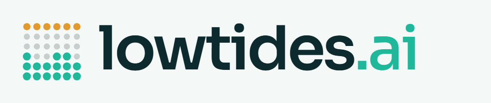

<p align="center"></p>

# Lowtides

**▶ Live demo: https://lowtides.ai** (no login needed). It's a public demo: PayPal sandbox and simulated AI models, so nothing costs real money, and there's a "Reset demo" button. Product overview and FAQ: https://lowtides.ai/why/

**The AI spend governor.** Keep AI spend at low tide.

Lowtides puts **one budget, one STOP button and one audit trail** over everything an AI agent spends:
- **What it costs to think:** model calls. Lowtides trims wasted context, answers repeats for free, routes easy steps to cheaper models, enforces hard budgets and stops runaway loops.
- **What it buys:** an agent asks Lowtides before every purchase. Your rules approve it, deny it or send it to you. Approved buys are paid to the merchant through **PayPal Payouts**, and the kill switch pulls back money that hasn't landed yet.

Your agents don't change. You point them at Lowtides instead of the model provider, or connect it as an MCP server, and Lowtides does the rest.

### What makes it different
| Problem (sourced in `docs/`) | What Lowtides does |
|---|---|
| Runaway loops run up overnight bills, and dashboards only report after the money is gone | Enforcement sits **in the request path**: daily allowances, per-job budgets, a loop guard, a combined AI-plus-purchases cap |
| A prompt-injected agent can be talked into paying a stranger | Unknown payees and instruction-like text are **held for a person**. Payees must be on your merchant list. |
| "I didn't buy that, my AI did": disputes need proof | A **hash-chained audit log** and a one-click **evidence pack** per purchase (request, reason, rules in force, who approved, payout) |
| Approval fatigue | Small, known, in-budget buys go through automatically. Only the risky ones wait, with the reason spelled out. |
| Rules are hard to set | Type them in **plain English**. Claude turns them into strict rules you review before saving. **The AI never decides a payment.** |
| Money already sent when something goes wrong | **KILL** stops the agent, denies pending buys, **voids PayPal holds** and **cancels unclaimed PayPal payouts** |

### Built on PayPal
- **Orders v2:** prepaid agent wallets (checkout top-ups), and quote-and-hold jobs (authorize, then capture only the real cost; void or refund the rest).
- **Payouts:** pay merchants for approved agent purchases; cancel unclaimed payouts from the kill switch.
- **Invoicing v2:** bill clients for their agents' usage, with the savings receipt in the memo.
- **Webhooks:** with signature verification, so top-ups and reversals are credited exactly once.

> **Renamed.** Lowtides v1.0 shipped under an earlier working name. Everything since Oct 1, 2026 is listed in the changelog.

---

## Why this exists

- AI agents use far more tokens than chat. A 2026 Stanford Digital Economy Lab study found agentic coding tasks use about 1,000x more tokens than code reasoning and code chat, mostly because the agent keeps re-reading its own growing history ([Stanford DEL](https://digitaleconomy.stanford.edu/publication/how-do-ai-agents-spend-your-money-analyzing-and-predicting-token-consumption-in-agentic-coding-tasks/), [arXiv 2604.22750](https://arxiv.org/abs/2604.22750)).
- The same study found that runs of the same task can differ by up to 30x in tokens, and that predicting the cost of a single run remains hard. Budgets have to be enforced while the agent runs, not estimated beforehand.
- Existing gateways are built for engineers. Almost nothing gives a business owner a simple allowance, a STOP button, a price before the work starts and a receipt in plain dollars.

---

## Quick start (about 2 minutes)

You need **Python 3.9 or newer**. There is nothing to install. Lowtides uses only Python's standard library.

**Windows:** double-click `run.bat`
**Mac or Linux:** `./run.sh`

Then open **http://localhost:8787**.

1. Name your agent and set its daily allowance.
2. Press **Turn it on**.
3. Copy the base URL and key into your agent.

Press **Watch it work (demo)** to see the whole pipeline run against a built-in simulated model, with no keys needed. Demo rows are labeled as simulated everywhere.

### Watch a runaway agent get caught (one command, about 1 minute)
With Lowtides running, open a second terminal and run:
```bash
python -m lowtides.scenario
```
Use `--fast` to skip the pauses. The script drives the real HTTP API the way an agent and its owner would:
1. Plain-English rules are saved.
2. The agent does honest work.
3. A $12 data purchase is auto-approved and paid.
4. A poisoned web page tries to redirect a payment. It's held as a new payee and possible prompt injection.
5. A $480 GPU rental is blocked.
6. A $45 dataset waits for you.
7. A growing retry loop is stopped by the loop guard on its 4th call.
8. **KILL** denies the pending buys and cancels the payout that hasn't landed yet.
9. The audit chain verifies.

Then open the **Approvals** tab to see every decision and download an evidence pack.

### Ask before buying (agents)
```bash
curl -X POST http://localhost:8787/v1/spend -H "Authorization: Bearer YOUR_LOWTIDES_KEY" -H "Content-Type: application/json" \
  -d '{"amount": 12.50, "merchant": "Acme Data", "item": "1,000 credits", "category": "data", "reason": "finish the lead list"}'
```
The answer is `approved`, `needs_approval` or `denied`, with reasons. The full API is in [docs/SPEND-API.md](docs/SPEND-API.md). Payouts go through PayPal when sandbox keys are set and the merchant has a PayPal email on your Merchants list. Otherwise they are **simulated and labeled as simulated**.

### Use real models

Set your keys as environment variables, then restart:

```bash
# Mac / Linux
export ANTHROPIC_API_KEY=sk-ant-...
export OPENAI_API_KEY=sk-...        # optional
./run.sh
```

```bat
:: Windows
set ANTHROPIC_API_KEY=sk-ant-...
run.bat
```

Keys are read from the environment only. They are never written to the config file or shown in the dashboard.

### Connect an agent

**OpenAI SDK (Python)**
```python
from openai import OpenAI
client = OpenAI(base_url="http://localhost:8787/v1", api_key="YOUR_LOWTIDES_KEY")
client.chat.completions.create(model="sim-large", messages=[{"role": "user", "content": "Hi"}])
```
`sim-large` is the built-in simulator, so this works with no keys. For real OpenAI-format calls, name a model on an OpenAI-compatible connection (OpenAI, OpenRouter or a local server). For Claude models, use the Anthropic SDK below.

**Anthropic SDK (Python)**
```python
import anthropic
client = anthropic.Anthropic(base_url="http://localhost:8787", api_key="YOUR_LOWTIDES_KEY")
client.messages.create(model="claude-opus-5-5", max_tokens=1024, messages=[{"role": "user", "content": "Hi"}])
```

Streaming (`stream: true`) works on both. Note: Lowtides gets the full answer first, checks it, then streams it to your agent. That's required to verify answers before your agent acts on them, so the first word arrives a little later than a direct stream would.

---

## What it does, step by step

| Step | What happens | Honest notes |
|---|---|---|
| **Answer memory** | An exact repeat of a request is answered free from memory. | Scoped to one agent. Answers that call tools are never reused, because replaying a tool call could repeat a real action. Near-duplicate matching applies only to short single questions (300 characters or less) with the exact same model, system prompt and settings. It ignores capital letters and end-of-sentence punctuation, but never matches a question with different numbers or symbols. A stopped or paused agent gets no answers from memory. Everything expires after 24 hours (configurable). Send `X-Lowtides-Memory: off` to skip it. |
| **Trim the snowball** | Old, long tool results are shortened (head and tail kept) and old exact duplicates are marked. | The system prompt and the most recent turns are never touched. No message is ever removed, so tool calls and results stay paired. Every cut is marked so the model knows. Skipped when your agent manages its own prompt cache, because trimming would break it. |
| **Prompt caching** | For Claude, long unchanging instructions and tool lists are marked cacheable. | Skipped if your request already uses caching. Only kicks in above a size threshold, since small prompts don't qualify. |
| **Pick the cheapest fit** | A free, instant grader scores each step easy, medium or hard and starts at the matching tier. | **Lowtides never moves you up to a pricier model than the one your agent asked for.** The requested model is the ceiling. If a cheaper model rejects part of the request (an image, extended thinking, a long context), Lowtides moves up instead of failing. |
| **Check and climb** | If an answer is empty, says it's unsure, is broken JSON when JSON was asked for, or is far too short, Lowtides tries the next model up. | Failed cheap attempts are counted in what you paid. If they cost more than going direct, the ledger says so. |
| **The governor** | STOP button, STOP ALL, daily allowance, per-job budget, prepaid wallet, speed limit, and a loop guard that pauses an agent that keeps sending the same request. | Blocked calls cost nothing. A paused agent stays paused until you press Resume. Budgets are checked against the priciest model a call could climb to. Retries after a provider outage don't count toward the loop guard. |
| **Fallback** | If a provider is down or rate-limiting, the next model in the ladder takes the call. | |
| **Receipt** | Every call is logged: model asked for, model used, tokens, cost, what it would have cost, and why. | See "How savings are calculated" below. |
| **Quality spot-checks** (optional) | A share of cheaper answers is also run on the model asked for, and the two are compared. | Off by default. It costs extra and is logged as extra spend, with no savings claimed. It is never billed to a client. |

### Quote before work (PayPal)

Like a contractor's estimate. Lowtides quotes a job from what similar finished jobs for that agent actually cost. With no history yet, it gives a clearly labeled rough estimate. You can hold the quote on PayPal. When the job is done, Lowtides captures only the real cost and releases the rest.

- **Rounding:** charges round to the nearest cent. Anything under half a cent is free, and the hold is simply voided.
- **Minimum hold:** $1.00, configurable. Tiny AI jobs aren't worth a card transaction, so use the wallet for small, frequent work and holds for bigger jobs.
- **Partial capture:** some PayPal accounts don't have it turned on. When PayPal refuses a partial capture, Lowtides captures the full hold and immediately refunds the difference, and the job record shows "capture then refund." It never tries this on a hold that has expired, been voided or already been used. The full capture is written down before the refund, so if a refund ever fails, the job shows it and the alert names the capture to refund in PayPal.
- **Marking a job done** without paying releases its hold.
- **A canceled approval** can be held again.

Agents group calls into a job with the header `X-Lowtides-Task: <job id>`. An unknown job ID is created automatically with the agent's default job cap.

### Prepaid wallet (PayPal)

Turn on **Pay from wallet** for an agent and it can spend only what you've loaded. Top-ups use PayPal Checkout. A top-up is credited exactly once, even if the return page and the webhook both arrive, and only when PayPal says the money itself is captured (a pending capture waits for PayPal's confirmation). If PayPal later reverses, denies or refunds a top-up, that amount comes back out of the wallet.

### Client invoices (Business mode, PayPal)

Assign agents to a client. Lowtides totals their usage for the period, adds your markup, and creates a PayPal invoice with the savings receipt in the memo. You can preview it before sending. Each invoice starts where the last one ended, so nothing is billed twice. Usage stays with the client it was made for, even if you move the agent to another client later.

---

## How savings are calculated

**"Would have cost"** (the baseline) is the same tokens priced on the model your agent asked for, with:
- no trimming (trimmed tokens are added back),
- no caching that Lowtides added (cache reads and writes are priced as normal input), and
- no answer memory.

If your agent already used caching itself, its cache pricing stays in the baseline, so Lowtides never takes credit for savings it didn't create. When the provider reports cached tokens on a call, trimmed tokens are priced at the cheap cache-read rate in the baseline, not full price.

**Saved** = baseline minus what you actually paid, including any failed cheap attempts. In the call list and CSV, a call that cost more than going direct shows a negative number. Totals never show a loss as a saving.

**Token counts** come from the provider's usage report. If a server doesn't report usage (some local servers), Lowtides estimates at about 4 characters per token and marks those rows **estimated**.

**Prices** are in `config.json` and on the Settings screen, per million tokens. The defaults reflect published rates as of October 2026. The Haiku 5.5 rate comes from third-party trackers. **Check every price against your provider's official pricing page.** The dollar math is only as right as these numbers.

---

## PayPal setup (sandbox)

1. Create a free account at developer.paypal.com and open **Apps & Credentials** (Sandbox).
2. Create an app and copy the **Client ID** and **Secret**.
3. Set them, plus your public address:
   ```bash
   export PAYPAL_CLIENT_ID=...
   export PAYPAL_CLIENT_SECRET=...
   ```
   Set `paypal.public_base_url` in `config.json` to where Lowtides is reachable, for example `https://your-app.onrender.com`. PayPal sends buyers back there after they approve.
4. Optional: add a webhook in the PayPal app pointing to `https://your-address/webhooks/paypal` for `CHECKOUT.ORDER.APPROVED`, `PAYMENT.CAPTURE.COMPLETED`, `PAYMENT.CAPTURE.DENIED`, `PAYMENT.CAPTURE.REVERSED` and `PAYMENT.CAPTURE.REFUNDED`, and set `PAYPAL_WEBHOOK_ID`. Lowtides verifies every webhook signature with PayPal and ignores duplicates. If an event can't be processed, Lowtides answers with an error so PayPal sends it again later.
5. If you plan to use holds, ask PayPal to enable partial capture on your account. Lowtides works without it, using capture-then-refund.

Sandbox is the default. Switch `paypal.env` to `live` only after testing.

---

## Deploy online

**Render:** connect the repo. `render.yaml` sets everything up and generates a dashboard password (`LOWTIDES_ADMIN_TOKEN`), which you can find in the Render dashboard. Add your model and PayPal keys there. Render's free disk is wiped on redeploy, so attach a persistent disk at `/var/data` if you want to keep your ledger.

**Docker:** `docker build -t lowtides . && docker run -p 8787:8787 -e LOWTIDES_ADMIN_TOKEN=choose-a-password -v lowtides-data:/data lowtides`

**Always set `LOWTIDES_ADMIN_TOKEN` before putting the dashboard online.** Lowtides refuses to start on a public address (`HOST=0.0.0.0`) without one. The agent API always requires a Lowtides key.

**Built-in protections:**
- The dashboard API refuses requests from other websites (Origin and Host checks, JSON-only writes). A page you visit can't press buttons in Lowtides for you, even on localhost.
- A connection can only read environment variables ending in `_API_KEY`, so no setting can point your PayPal secret or dashboard password at someone else's server.
- Passwords are compared in constant time.

---

## Customize everything

The **Settings** screen, or `config.json`, controls:
- **Rules:** trimming, caching, memory, routing mode (cascade, route or off), verification, loop limits, speed limit, output cap, near-duplicate threshold, spot-check rate and default budgets.
- **Models:** add any model with its prices, ladder group (models that can stand in for each other) and tier (1 cheapest to 3 strongest).
- **Connections:** add any OpenAI-compatible server, such as OpenAI, OpenRouter, Groq, Together, Ollama or LM Studio. Add its models with a $0 price for free local models.

Per-call headers your agent can send:
- `X-Lowtides-Task: <id>` and `X-Lowtides-Task-Label: <name>` group calls into a job
- `X-Lowtides-Tier: 1|2|3` overrides the grader for that call (still capped at the requested model)
- `X-Lowtides-Memory: off` skips answer memory

Response headers your agent receives:
- `X-Lowtides-Model-Used`, `X-Lowtides-Cost`, `X-Lowtides-Saved`
- `X-Lowtides-Budget-Left-Today`, plus `X-Lowtides-Task-Left` when a job is set

---

## Plug in any agent (copy and paste)

Lowtides speaks the OpenAI-style API, so almost any agent connects by changing two values: the base URL and the key. Add an agent on the dashboard to get its `lt-` key. **Connect** then shows these snippets with your own URL and key filled in.

**Python (OpenAI SDK)**
```python
from openai import OpenAI
client = OpenAI(base_url="https://lowtides.ai/v1", api_key="lt-your-agent-key")
print(client.chat.completions.create(model="sim-large", messages=[{"role": "user", "content": "Hello!"}]).choices[0].message.content)
```

**LangChain** (CrewAI, LlamaIndex and most agent frameworks take the same two values)
```python
from langchain_openai import ChatOpenAI
llm = ChatOpenAI(base_url="https://lowtides.ai/v1", api_key="lt-your-agent-key", model="sim-large")
print(llm.invoke("Hello!").content)
```

**Ask before buying** (approved, held for a person, or blocked, with reasons)
```bash
curl https://lowtides.ai/v1/spend -H "Authorization: Bearer lt-your-agent-key" -H "Content-Type: application/json" \
  -d '{"amount": 12, "merchant": "Acme Data", "item": "1,000 lead credits", "category": "data", "reason": "Finish the lead list"}'
```

Claude, Cursor and other MCP apps: see the next section.

## Leash: stop data dumps

An agent can blow your budget in one call by pasting a huge file into a prompt or writing a giant reply. The leash is a per-agent limit on single calls. Open **Rules** on the dashboard and set:

- **Max reply length** and **Biggest prompt allowed** (in pages)
- **Max cost per AI call**
- **Alert when a call is X times bigger than usual** (default 5)

Or just write it: `Keep replies short. Never send more than 50 pages. No single call over 25 cents.` Calls over a limit are blocked with a message the agent can read; unusually big ones are flagged. Token counts are estimates. Details: [docs/LEASH.md](docs/LEASH.md).

## Use Lowtides from any agent (MCP)

`python -m lowtides.mcp` runs a stdio MCP server that gives an agent three tools: `request_spend`, `check_spend` and `get_budget`. They call the Lowtides `/v1` spend API (see `docs/SPEND-API.md`). Add it to Claude Desktop or Claude Code (run from the repo folder, or set `cwd`):

```json
{
  "mcpServers": {
    "lowtides": {
      "command": "python",
      "args": ["-m", "lowtides.mcp"],
      "env": {
        "LOWTIDES_URL": "http://localhost:8787",
        "LOWTIDES_AGENT_KEY": "lt-your-agent-key"
      }
    }
  }
}
```

The same config works for any MCP client that can launch a stdio server.

### Guard PayPal's own Agent Toolkit

Lowtides can sit in front of PayPal's own Agent Toolkit. Add one line, and every capture, subscription or dispute payout an agent attempts needs Lowtides' OK first. The same rules, approvals, kill switch and tamper-evident audit log apply, and the agent needs no rewrite. See [integrations/paypal-agent-toolkit](integrations/paypal-agent-toolkit/) and [docs/PAYPAL-AGENT-TOOLKIT.md](docs/PAYPAL-AGENT-TOOLKIT.md).

---

## Outside spend guard

Lowtides' budgets only see calls that go through its proxy. A script that calls Anthropic or OpenAI directly can run up a bill they never see. The outside spend guard watches your provider's own cost report instead, so it catches spend from any tool or script.

- Daily and monthly caps per provider, plus combined caps, with an alert at 80% by default.
- At the cap it switches off only the keys you list, writes an audit entry, shows a red banner and presses STOP ALL.
- Anthropic keys are set to inactive (reversible). OpenAI keys are **deleted** (permanent).
- Billing data lags, so it caps the damage but cannot make it zero.

Off by default. It needs an org admin key set as an environment variable. See [docs/OUTSIDE-GUARD.md](docs/OUTSIDE-GUARD.md).

---

## Known limits

- **API only.** Lowtides governs API-billed agents. It can't sit in front of subscription chat apps, which aren't billed per call.
- **One API family per ladder.** It routes within one family: Claude models via the Anthropic API, or models on OpenAI-compatible servers. It does not translate requests between the two formats.
- **The grader is a heuristic.** It's free and instant, which is the point. The verify-and-climb step catches its misses, and you can turn routing off for any agent's workload that needs the top model every time.
- **Single server.** It uses SQLite and in-memory loop tracking, so run one instance.
- **Purchases are only as governed as the agent is honest about using them.** Lowtides governs purchases that go through `/v1/spend` (or the MCP tool) and pays them itself. An agent holding its own card or wallet can go around it. That's why payouts come from your PayPal account, not the agent's.
- **Injection detection is a tripwire, not a guarantee.** It holds requests whose text reads like instructions. The real protection is that new payees always need a person.
- **Payout cancel only works before the receiver claims the money.** After that, use a PayPal refund or dispute, which the evidence pack is built for.

---

## Tests

```bash
cd tests && python -m unittest test_core test_http test_fixes test_mcp test_spend
```

The 125 tests run with no internet and no money. Local fake servers speak the real PayPal, Anthropic and OpenAI wire formats, so Lowtides's real HTTP clients are exercised end to end. They cover routing, escalation, memory safety (wrong-answer cases included), trimming, budgets, the loop guard, wallets (including pending and reversed payments), holds (partial capture, the capture-then-refund fallback, failed refunds and void), invoices (no double billing), webhook verification and retries, streaming, cross-site protection, the admin lock and path safety.

`test_fixes.py` holds a regression test for every issue found in an independent code review before release. `test_spend.py` covers every purchase rule, PayPal payouts and payout cancel, approvals, the kill switch, audit-chain tamper detection, evidence packs, forecasts and the plain-English rule parser. `test_mcp.py` covers the MCP server.

The dashboard's "Every call" table uses [AG Grid](https://www.ag-grid.com/) Community.

---

## License

Copyright (c) 2026 Eye To Ad Media. Licensed under the GNU Affero General Public License v3.0 (AGPL-3.0). See `LICENSE`.

If you run a modified version of Lowtides as a network service, the AGPL requires you to offer your users the source code of your version.

Contributions are not accepted for now.
