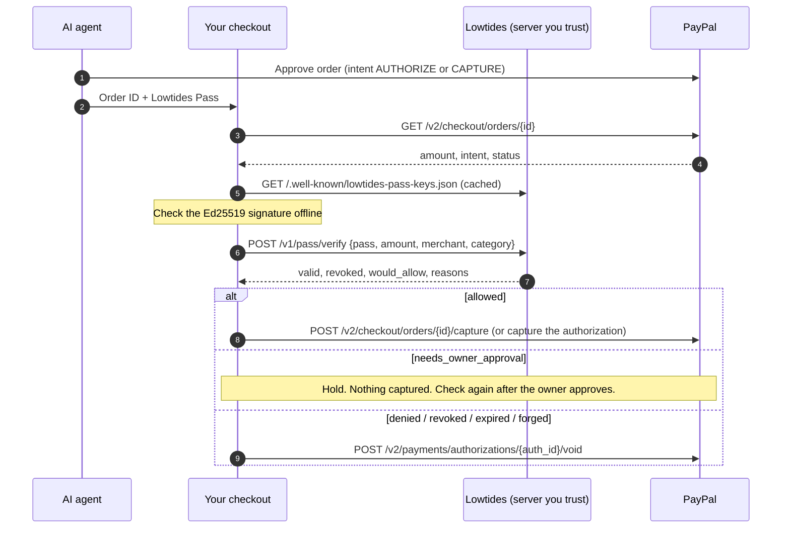

# Merchant check: verify an AI agent's Lowtides Pass before you take its money

An AI agent wants to pay you through PayPal. The buyer approved the order, but is the agent **still** allowed to spend this much at your store? Maybe its owner pressed Stop all a minute ago, or the amount is over its limit.

The agent carries a **Lowtides Pass**: a signed spending permission from the Lowtides server that governs it. Check it right before you capture, and you only take money the owner still allows. That means fewer refunds, disputes and chargebacks from runaway or hijacked agents.

Try it live: **[/merchants/](https://lowtides.ai/merchants/)** (checkout simulator with a real pass).

## The flow in plain English

1. The agent sends you its order and its pass.
2. You read the amount from the **PayPal order**, never from what the agent says.
3. You ask Lowtides: "Is this pass genuine, not revoked, and allowed to spend this amount at my store?" The signature can also be checked offline.
4. Lowtides answers, and you act:
   - **allowed** -> **capture**
   - **needs_owner_approval** -> **hold**: don't capture; the owner approves in Lowtides, then you check again
   - **denied**, revoked, expired or forged -> **refuse**, and **void the authorization** if you placed one, so the buyer's money is released
5. If Lowtides can't be reached, the answer is **hold**. The check fails closed.



## Files

| File | What |
|---|---|
| `lowtides-pass-check.js` | Dependency-free ES module for browsers and Node 18+. `checkPass()` returns `capture` / `hold` / `refuse` with reasons. Checks the signature offline with Web Crypto Ed25519 when the runtime has it (keys cached 5 minutes), and always checks revocation online. |
| `paypal_capture_guard.py` | Standard-library Python. `CaptureGuard.capture(order_id, pass)` reads the order from PayPal, checks the pass for that amount, then captures, holds, or refuses and voids. Has a dry run and a PayPal sandbox demo. |
| `lowtides-pass-check.test.mjs` | `node --test` tests for the JS module (own Ed25519 key, fake server). |

Python tests: `tests/test_merchant_guard.py` (a fake PayPal and a real local Lowtides server issuing passes).

## JavaScript

```js
import { checkPass } from "./lowtides-pass-check.js";

const order = await paypal.getOrder(orderId);                 // your PayPal client
const v = await checkPass({
  pass: req.body.lowtidesPass,                                // sent by the agent
  amount: Number(order.purchase_units[0].amount.value),       // from PayPal, not the agent
  merchant: "Acme Data",
  category: "data",
  verifyUrl: "https://lowtides.ai/v1/pass/verify",            // the Lowtides server you trust
});
if (v.decision === "capture") await paypal.captureOrder(orderId);
else if (v.decision === "refuse") await paypal.voidAuthorization(authId);
// "hold": keep the order open until the owner approves in Lowtides
console.log(v.label, v.reasons, v.offline.signatureOk, v.revoked, v.wouldAllow);
```

Also exported: `decodePass(token)`, `verifyOffline(token, {verifyUrl})`, `hasWebCryptoEd25519()`, `clearKeyCache()`.

## Python

```python
from paypal_capture_guard import CaptureGuard, PayPalOrders

guard = CaptureGuard(PayPalOrders(CLIENT_ID, SECRET),          # sandbox by default
                     merchant="Acme Data", category="data",
                     verify_url="https://lowtides.ai/v1/pass/verify",
                     trusted_issuer="https://lowtides.ai")      # optional: refuse passes from other servers
result = guard.capture(order_id, agent_pass)
print(result["action"], result["voided"], result["reasons"])   # captured | held | refused
```

From the command line:

```bash
# Dry run: no PayPal keys, no PayPal calls. Shows what the guard would do.
python paypal_capture_guard.py --lowtides http://127.0.0.1:8787 --pass "PASTE_THE_PASS" --amount 45 --merchant "Acme Data"

# Sandbox demo: creates a sandbox order, you approve it as the sandbox buyer, then the guard decides.
PAYPAL_CLIENT_ID=... PAYPAL_CLIENT_SECRET=... \
python paypal_capture_guard.py --lowtides http://127.0.0.1:8787 --agent-key lt-... --amount 12 --intent AUTHORIZE
```

Exit codes: `0` captured, `2` held, `3` refused. The demo refuses to run against live PayPal.

## curl

```bash
curl -s -X POST https://lowtides.ai/v1/pass/verify -H "Content-Type: application/json" \
  -d '{"pass": "PASTE_THE_PASS", "amount": 45.00, "merchant": "Acme Data", "category": "data"}'
```

`would_allow` is `allowed`, `needs_owner_approval` or `denied`. An invalid, expired or revoked pass is always `denied`. Nothing is recorded.

## Trust rules

- Use the amount from the PayPal order.
- Use the verify URL **you** configured. Never follow the `status_url` or `iss` inside a pass: anyone can run a Lowtides server, and a pass shouldn't get to pick who vouches for it. Set `trusted_issuer` to be strict.
- The offline signature check alone can't see revocation. Always do the online check before money moves (both files do).
- Check right before capture, not when the cart is created.
